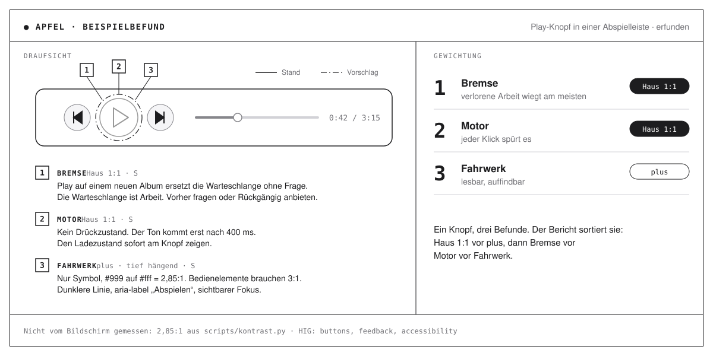

# apfelkern

[English](README.md) · **Deutsch**



**Apfel ist ein Skill für Claude Code.** Er prüft Dialoge im Browser, in denen Menschen arbeiten:
Masken, Tabellen, Formulare, Speichern. Jeder Befund nennt seine Quelle. Das ist eine Zeile im
Code, eine Seite in Apples Human Interface Guidelines oder ein Vorbild im eigenen Projekt.

> „12 px #999 auf Weiß, 2,85:1“ statt „schlecht lesbar“. Zahl statt Adjektiv.

## Was Apfel prüft

| Baugruppe | Frage | Prüfpunkte |
|---|---|---|
| **Motor** | Reagiert der Dialog sofort? | 8 |
| **Fahrwerk** | Findet man sich zurecht? | 15 |
| **Bremse** | Geht Arbeit verloren? | 10 |

Die Bremse kommt zuerst. Verlorene Arbeit wiegt am schwersten.

## Wie der Bericht aussieht

Jede Station des Dialogs zeigt drei Stände nebeneinander:

- **Bestand:** der alte Dialog, wie er heute läuft.
- **Haus 1:1:** dieselbe Funktion im Bild des eigenen Maßstabs.
- **plus:** Vorschläge darüber hinaus, mit Aufwand S, M oder L.

Sechs feste Regeln entscheiden, was in Haus 1:1 gehört. Bei Unklarheit entscheidet das Team.

## Befehle

| Befehl | Wirkung |
|---|---|
| `apfel` | Begrüßung und Menü |
| `apfel <dialog>` | voller Review |
| `apfel kurz <dialog>` | nur Urteil und die drei wichtigsten Vorschläge |
| `apfel zeichnung <dialog>` | Review mit Befundzeichnung |
| `apfel profil` | Profile ansehen, anlegen und prüfen |
| `apfel erklären` | Seite, die zeigt, wie Apfel arbeitet |

## Profile

Ein Profil beschreibt den Maßstab eines Projekts. Es ist eine Markdown-Datei. Darin stehen das
Vorbild, die Grenzen und je Thema eine Fundstelle.

- Eigene Profile liegen in `~/Documents/Apfel/profile/`. Sie bleiben privat.
- Im Team liegt das Profil als `.apfel/profil.md` im Projekt.
- Ohne Profil prüft Apfel gegen Apples Regeln.

## Grundsätze

- Apfel liest nur. Er ändert keinen Code.
- Apples Seiten lädt er live. Er speichert sie nicht.
- Die Skripte laufen lokal. Sie brauchen nur Python 3.

## Installieren

Als Plugin in Claude Code:

```text
/plugin marketplace add rdo2hellowelt/apfelkern
/plugin install apfel@apfelkern
```

Danach in einem Projekt `claude` starten und `apfel` tippen. Die Ergebnisse landen in
`~/Documents/Apfel/`.

## Lizenz

MIT, © 2026 Hans M. Apfel ist unabhängig und gehört nicht zu Apple Inc.

---

<sub>Gebaut mit Stolz bei hellowelt. Proud of it? Türlich. Türlich Türlich Digga.</sub>
